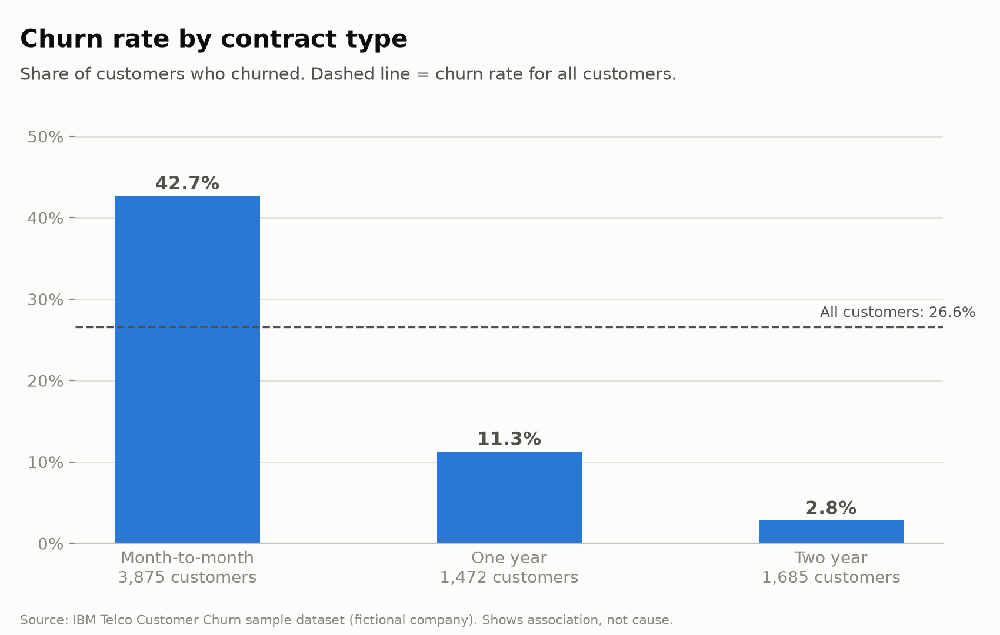
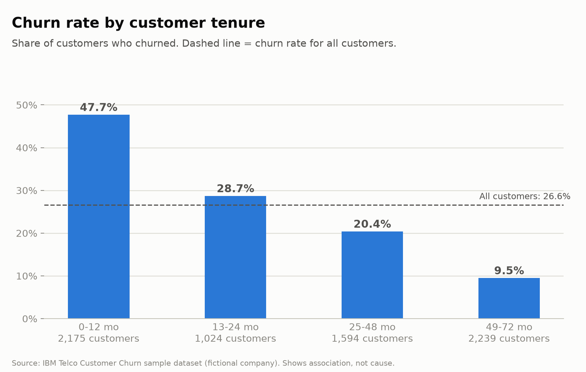
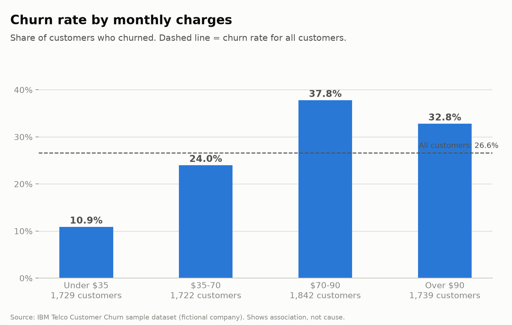
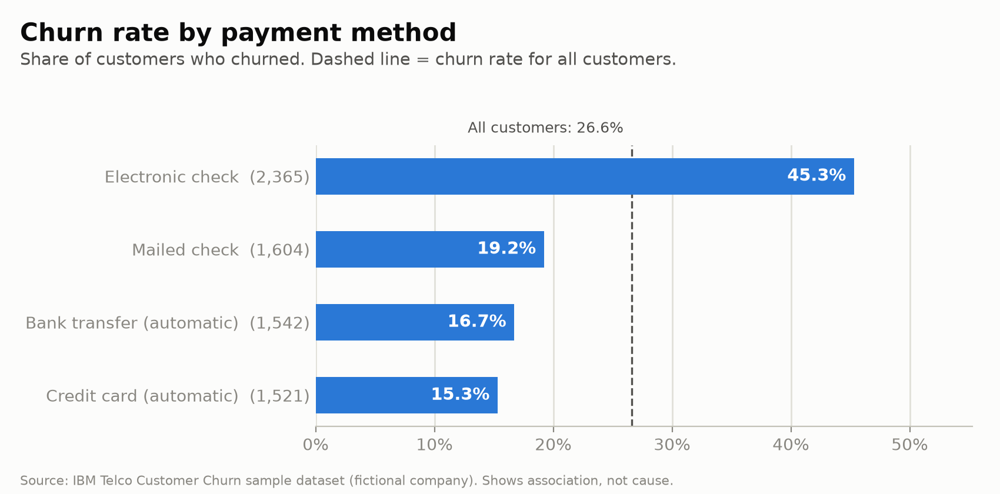
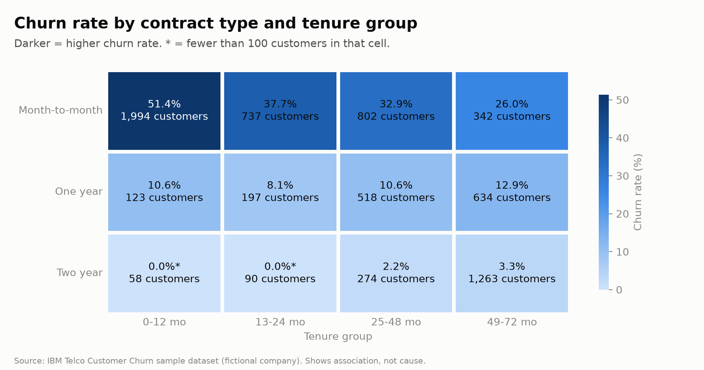

# Customer Churn Analysis (Telco Sample Dataset)

> **Project status: exploratory analysis complete.** This is a learning project using a fictional
> telecom sample dataset. It does not build a churn prediction model or establish causes of churn.

## Business question

Among the customers of a subscription telecom company, which characteristics (contract type,
tenure, monthly charges and other account details) are associated with higher churn, and what
retention actions could the company test?

This is an **exploratory analysis**. It finds patterns across groups of customers. It cannot
prove why any individual customer left, and it does not show that any characteristic *causes* churn.

## Dataset

- **Name:** IBM Telco Customer Churn (sample dataset for a *fictional* telecom company)
- **Kaggle:** https://www.kaggle.com/datasets/blastchar/telco-customer-churn
- **IBM source post:** https://community.ibm.com/community/user/businessanalytics/blogs/steven-macko/2019/07/11/telco-customer-churn-1113
- **Raw data:** 7,043 rows and 21 columns. After cleaning, 7,032 rows remained; 11 rows with
  blank `TotalCharges` values were excluded.
- **Outcome column:** `Churn` (Yes/No) - whether the customer left within the last month
- **License / terms:** Kaggle labels the data files "© Original Authors"; an open reuse license is
  not specified on the dataset page. The raw and cleaned CSV files are therefore excluded from
  this repository. Download the data from its source and review its current terms before use.
- **Not included in this repo.** The CSV is not redistributed here. Download it yourself and
  place it in `data/raw/` (see "How to run").

## Project structure

```
churn-analysis/
├── data/
│   ├── raw/          <- put the downloaded CSV here (never edited)
│   └── processed/    <- cleaned file created by script 02
├── scripts/
│   ├── config.py               shared paths and analysis choices
│   ├── 01_load_and_check.py    load + data-quality checks (changes nothing)
│   ├── 02_clean_data.py        cleaning, new columns, saves cleaned CSV
│   ├── 03_explore_churn.py     churn-rate tables, saved to outputs/tables/
│   └── 04_make_charts.py       charts, saved to outputs/figures/
├── outputs/
│   ├── figures/
│   └── tables/
├── docs/INTERVIEW_NOTES.md     plain-language explanations and interview prep
├── requirements.txt
└── README.md
```

## How to run

Requires Python 3.9+.

```bash
# 1. Create and activate a virtual environment (Mac/Linux)
python3 -m venv .venv
source .venv/bin/activate

# 2. Install libraries
pip install -r requirements.txt

# 3. Download the dataset from Kaggle (link above) and put the .csv file in data/raw/

# 4. Run the scripts in order, from the project folder
python scripts/01_load_and_check.py
python scripts/02_clean_data.py
python scripts/03_explore_churn.py
python scripts/04_make_charts.py
```

## Methods

1. **Load and check** (`01`): shape, data types, missing values (including blank text),
   duplicates, categories in each column.
2. **Clean** (`02`): trim whitespace; convert `TotalCharges` to a number; drop rows where it
   could not be converted (the script prints how many, and stops if it is more than 2% of rows);
   remove duplicate customer IDs; create `churn_flag` (1/0), `tenure_group` and `charge_band`.
   - 11 rows were removed because `TotalCharges` was blank and could not be converted to a number
     (11 of 7,043 rows, about 0.16%). No duplicate customer IDs were found in the cleaned data.
3. **Explore** (`03`): churn rate (churned customers / all customers in the group) for each
   characteristic, averages for churned vs stayed customers, and a cross-table of contract type by
   tenure group to check whether two patterns overlap.
4. **Visualize** (`04`): bar charts, distribution comparison, and a heatmap. Bars start at zero,
   every chart shows group sizes or a baseline, and titles describe what is plotted.

Tools: Python, pandas, matplotlib, seaborn.

## Key findings

- **Overall churn rate:** 1,869 of 7,032 customers churned (26.6%).
- **Contract type:** Churn was 42.7% for month-to-month customers (3,875 customers), 11.3% for
  one-year customers (1,472), and 2.8% for two-year customers (1,685).
- **Tenure:** Churn was 47.7% in the 0-12 month group (2,175 customers) and 9.5% in the 49-72
  month group (2,239).
- **Monthly charges:** Churn was 10.9% below $35, 24.0% from $35-$70, 37.8% from $70-$90, and
  32.8% above $90. The pattern is not a steady increase across every band.
- **Other characteristics:** Electronic-check customers had a 45.3% churn rate; customers with
  tech support had 15.2%, compared with 41.6% among customers without tech support. These groups
  may differ in other ways, so these comparisons do not show cause.
- **Overlap check (contract x tenure):** Month-to-month churn remained higher than the overall
  rate in each tenure group (26.0%-51.4%). Contract and tenure are related, so both should be
  considered when interpreting the single-factor comparisons. The two-year contract groups under
  24 months have fewer than 100 customers and their rates are less stable.











## What the patterns do and do not tell us

The largest differences were across contract type and tenure: month-to-month and newer customers
had higher churn rates in this sample. Churn was also higher among electronic-check customers and
customers without tech support, though these characteristics may overlap with contract type,
tenure, or service choices. Monthly charges did not show a steady increase in churn across every
charge band. These are group-level associations in a fictional snapshot dataset, not evidence that
any characteristic caused an individual customer to leave.

## Recommended actions to test

These are proposals for a real company to test; this sample analysis cannot show whether they would
work.

1. **Early-tenure support test:** Randomly offer an onboarding check-in to a portion of new
   customers, keep a comparable group on the current experience, then compare 3- or 6-month churn.
2. **Contract renewal test:** Among eligible month-to-month customers, test a clearly explained
   annual-plan offer against the current renewal experience. Compare retention and revenue after
   accounting for discounts and service costs.
3. **Support outreach test:** Test proactive technical-support outreach for customers who opt in
   or show support needs; compare subsequent churn and support costs with a control group.

## Limitations

- **Sample, fictional data.** Findings describe this dataset only, not real companies.
- **Association, not causation.** Groups differ in many ways at once. For example, long-tenure
  customers and long-contract customers overlap heavily.
- **A snapshot.** `Churn` marks who left in the last month; there is no history showing how
  behavior changed before leaving.
- **Missing context.** There is no information on competitor offers, service quality, price
  changes or customer complaints, which often drive churn in real businesses.
- **Analysis choices matter.** Tenure groups and monthly-charge bands use cut points I chose
  (see `config.py`). Different cut points could shift the numbers somewhat.
- **Small groups.** Percentages from small groups are unstable; scripts flag groups under 100 customers.
- **No predictive model.** This project describes patterns; it does not predict individual customers.
- Eleven records with blank `TotalCharges` were excluded; results could shift if those records
  were handled differently.

## Possible next steps

- Compare different tenure and charge cut points to see whether conclusions hold.
- Add a statistical check (for example, a chi-square test) on the main group differences.
- Only after the analysis above is understood: a simple, explainable predictive model.

## Credits

Dataset: IBM Sample Datasets (Telco Customer Churn), obtained via Kaggle.

## AI assistance

Claude helped create the initial project structure and scripts. I ran the scripts on the dataset
and am using this project to learn and explain the data-cleaning and exploratory-analysis steps.
